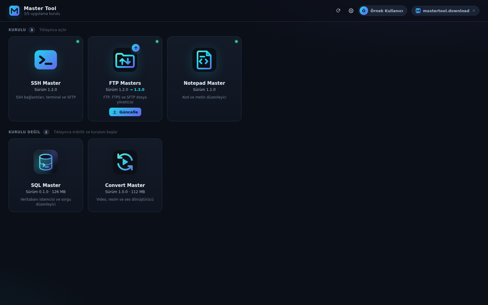

# Master Tool

Mastertool ailesinin Windows masaüstü başlatıcısı. SSH Master, FTP Masters, SQL Master, Notepad Master, Convert Master ve Video Master'ı
**kurulu** ve **kurulu değil** diye iki grupta gösterir:

- Kurulu uygulamaya tıklayınca uygulama açılır (açıksa penceresi öne gelir). Yeni sürüm varsa simgede rozet ve **Güncelle** düğmesi.
- Kurulu olmayana tıklayınca simgenin üzerinde dairesel ilerleme (yüzde + MB) görünür; kurulum dosyası
  `%APPDATA%\Mastertool\downloads` klasörüne indirilir, SHA-256 ile doğrulanır ve kurulum başlatılır. Kurulum bitince
  uygulama kendiliğinden **Kurulu** grubuna geçer, kurulum dosyası silinir. İndirme sürerken tekrar tıklamak iptal sorar.
- **Tek giriş (SSO):** Master Tool'da ya da ailedeki herhangi bir uygulamada bir kez giriş yapılınca diğerleri şifre sormaz;
  herhangi birinde çıkış yapılınca hepsinde oturum kapanır.
- **Tepsi:** simge her zaman tepside. Küçültme ve kapatma tepsiye gönderir. Tek tık kurulu uygulamaları menü olarak açar
  (tıklayınca uygulama açılır, gizliyse gösterilir); çift tık Master Tool penceresini gösterir.

Sunucu sözleşmesi: mastertool.download `docs/mastertool-api.md` (v1).



## Arayüz standardı

Ailenin diğer uygulamalarıyla aynı iskelet (SSH Master `docs/mastertool-standard.md`): Electron + electron-builder NSIS,
8 dil (tr, en, fr, de, es, ar sağdan sola, zh, ru), tema Gece / Gündüz / Sistem (varsayılan Sistem), bölümlü Ayarlar
(Genel · Hesap · Depolama · Hakkında), Windows ile başlat (`--hidden`), güncelleme denetimi. Kurulum
`Program Files\Mastertool\Master Tool`, Başlat menüsü klasörü **Master Tool** (`build/installer.nsh`, SSH Master `5cc0578`).

## Dosyalar

| Dosya | Görevi |
| --- | --- |
| `src/main.js` | Pencereler, tepsi, katalog (`GET /api/mt/apps`), kurulu algılama, açma, indirme/kurma, kendi güncellemesi, IPC. |
| `src/sso.js` | Cihazda ortak oturum: Windows Kimlik Bilgisi Yöneticisi (`@napi-rs/keyring`, `Entry('Mastertool', 'sso')`) ve `%APPDATA%\Mastertool\sso-state.json` (fs.watch + 5 sn yoklama). |
| `src/account.js` | Giriş (`/api/mt/auth/login`, `client: "desktop"`), çıkış, 401'de tüm aileyi kapatma, başka uygulamadaki giriş/çıkışı izleme. |
| `src/api.js` | HTTP istemcisi, PBKDF2 türetme (`master`, `auth_hash`), sürüm karşılaştırma. |
| `src/detect.js` | HKCU/HKLM (64 + 32 bit) Uninstall kayıtları (PowerShell + .NET, UTF-8) ve yedek yollar. |
| `src/downloader.js` | `.part` dosyasına akış, ilerleme, `X-Sha256` doğrulama, iptal; Depolama listesi/temizliği. |
| `src/installs.js` | İndir → kurulumu başlat → 2 sn'de bir yeniden tara (kurulum kapandıktan sonra 2 dk) → bitir. Aynı anda birden çok iş. |
| `src/tray-menu.js` | Tepsi menüsü şablonu ve tek tık / çift tık ayrımı. |
| `src/i18n.js` | 8 dilin sözlükleri. |
| `src/renderer/` | Giriş ekranı, ana pencere (kutucuklar, ilerleme halkası), Ayarlar. |
| `test/` | `npm test` — kurulu algılama, ortak kimlik akışları, indirme + sha256, kurulum bekleme, tepsi menüsü, dil eşliği. |

## Ortak oturum (sözleşme v1 §2)

Ortak kimlik (Kimlik Bilgisi Yöneticisi, hedef adı `sso.Mastertool`):

```json
{"v":1,"email":"…","user":{"id":1,"name":"…"},"sso_token":"…","master":"<base64 32 bayt>","kdf":{"alg":"PBKDF2-SHA256","iter":600000,"salt":"…"},"at":1760000000000}
```

- Windows kimlik bilgisi blob'u en çok 2560 bayttır ve keyring parolayı **UTF-16** yazar; bu yüzden JSON en çok 1200 karakter
  tutulur (gerekirse ad kısaltılır).
- Durum dosyası `{"gen","state","at"}` geçici dosyaya yazılıp yerine taşınır (okuyan uygulama yarım dosya görmez).
- Durum değişince gerçek durum ortak kimlikten okunur: kimlik varsa ve token farklıysa o kullanılır, yoksa oturum kapatılır.
- Master Tool yalnız `/api/mt/*` uçlarını kullandığından ayrı uygulama token'ı tutmaz; `sso_token` Bearer olarak gönderilir.

## Geliştirme

```bash
npm install
npm start            # Electron ile çalıştırır
npm test             # birim testleri (Electron gerekmez)
npm run icon         # build/icon.svg → icon.png + icon.ico
npm run screenshots  # docs/screenshots/*.png + manifest.json (örnek verilerle, Playwright Chromium)
npm run dist         # Windows kurulum + taşınabilir exe
```

`MT_API` ortam değişkeni sunucu adresini değiştirir (varsayılan `https://mastertool.download`).

## Sürüm yayını

`v1.2.3` etiketi gönderilince GitHub Actions exe'leri derler, Release'e ekler ve `scripts/upload-mastertool.sh` ile
mastertool.download'a ≤ 90 MB parçalar halinde yükler (`POST /api/mt/releases/<sürüm>/setup`, sonra `/portable`).
Anahtar depo secret'ı `MASTERTOOL_RELEASE_KEY`'dedir; tanımlı değilse yükleme adımı atlanır.
